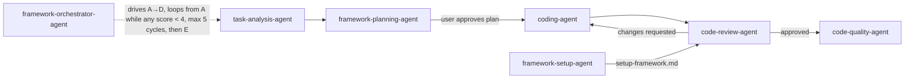

# AI Assistant Instructions (start here)

Canonical, tool-agnostic guidance for any AI coding assistant or automation-pipeline agent
working in this repository (Claude Code, OpenAI Codex, GitHub Copilot, Cursor, Gemini CLI, …).
Tool-specific entry files (`CLAUDE.md`, `AGENTS.md`) only point here — **all repo context lives
in `.ai/context/`**. Edit these files, never the tool-specific entry files, when rules change.

## Repository

`qe-base-js` is a TypeScript central automation framework: a pnpm-workspace monorepo of paired
**BOM** packages (dependency-version pinning only, no code) and **base** packages (the real
framework code — fixtures, page objects, API clients, config loaders, CLI, retry helpers) that
other QE repos consume, either by taking on a BOM's pinned/enforced dependency versions or by
depending directly on a base package's code. It mirrors the sibling Java repo
`qe-bom-base-java`'s architecture, translated to Node/TypeScript/pnpm. See `README.md` for the
full picture once it exists, and `.ai/skills/_shared/framework-guidelines.md` for the
authoritative architecture reference (layering rules, the 10 design principles, and — most
importantly — the BOM dependency-enforcement/override mechanism in its §5).

**There is no end-to-end application under test here.** This repo's own "tests" are self-tests
that prove the framework's base classes/fixtures/utilities behave correctly, run against local
stubs/mocks — never a live external target.

## Reading order (mandatory before any task)

1. `.ai/context/ai-assistant-instructions.md` — this file
2. `.ai/skills/_shared/framework-guidelines.md` — the architecture: layering, the 10 design
   principles made concrete, the BOM enforcement/override mechanism, verification commands
3. `.ai/context/test-tagging.md` — Playwright Test's `tag` option, classification + unique tags
4. `.ai/context/self-test-verification-workflow.md` — explore-before-you-code rule for this
   framework's own self-tests (local stubs/mocks, never a live site)
5. `.ai/context/framework-learnings.md` — accumulated, repo-specific lessons

Rules in these files override default assistant behaviour and anything in a skill or agent file.

## Terminology used across `.ai/`

- **Sandbox override** — run the command outside the assistant's restricted command sandbox
  (filesystem/network-limited shell), using whatever mechanism your tool provides (e.g. Claude
  Code's `dangerouslyDisableSandbox`, Codex's full-access/approval mode). If your tool has no
  sandbox, run normally. Required from the start for any self-test run that launches a real
  browser or binds a local port.
- **Ask the user** — use your tool's structured-question UI if it has one; otherwise ask in plain
  text, one question at a time. When running non-interactively, stop and return the questions.
- **Skill** — a step-by-step procedure in `.ai/skills/<name>/SKILL.md`.
- **Agent** — a role definition in `.ai/agents/<name>.md` that runs one skill autonomously and
  reports back. YAML frontmatter follows the Claude Code subagent format; the body is plain
  instructions any tool can follow. Agents here are thin wrappers — the procedure lives in the
  skill, not duplicated in the agent file.
- **BOM package** — a `@qe/bom-*-js` workspace package: no source code, just a `package.json` +
  `qe.bom.json` manifest pinning third-party dependency versions for one technology slice.
- **Base package** — a `@qe/base-*-js` workspace package: real framework code, consumed directly
  by downstream repos or indirectly via its paired BOM.

## Skills and agents

| Step | Skill                           | Agent                                      | Input → Output                                                                                                                                                                               |
| ---- | ------------------------------- | ------------------------------------------ | -------------------------------------------------------------------------------------------------------------------------------------------------------------------------------------------- |
| 0    | `orchestrate-framework-changes` | `framework-orchestrator-agent`             | change request → runs steps 1–4 in up to 5 cycles until every review score ≥ 4 (else `docs/orchestration/<slug>-abort.md`), then step 5 → learnings + `docs/orchestration/<slug>-summary.md` |
| 1    | `analyze-task`                  | `task-analysis-agent`                      | task text/link → `docs/requirements/<slug>-requirements.md`                                                                                                                                  |
| 2    | `plan-framework-code-changes`   | `framework-planning-agent`                 | requirements + affected package(s) → `docs/plans/<slug>-plan.md`                                                                                                                             |
| 3    | `make-code-changes`             | `coding-agent`                             | plan md → code + `docs/changes/<slug>-changes.md`                                                                                                                                            |
| 4    | `review-code-changes`           | `code-review-agent`                        | change manifest md → `docs/reviews/<slug>-review-cycle-<n>.md` (scores 1–5)                                                                                                                  |
| 5    | `check-code-quality`            | `code-quality-agent`                       | change manifest / codebase → `docs/quality/<slug>-quality.md`                                                                                                                                |
| —    | `scaffold-qe-module`            | — (run directly, not via the orchestrator) | technology name + dependent packages → `docs/framework/scaffold-module-plan.md` (approval) → code → `docs/framework/scaffold-module.md`                                                      |
| —    | `mutation-testing`              | `mutation-testing-agent`                   | package + its self-tests, `MUTATION_ENABLED=true`                                                                                                                                            | mutations injected, executed, evidence-backed `docs/mutation/<slug>-mutation.md` |
| —    | `setup-qe-base-framework`       | `framework-setup-agent`                    | scoping answers → `docs/plans/framework-setup-plan.md` (approval) → changes + `docs/setup-framework.md`                                                                                      |
| —    | `learn-and-build-framework`     | `learn-and-build-framework-agent`          | mode (LEARN / BUILD / INTERVIEW_PREP / ALL) → architecture discovery / step-by-step package construction / `docs/interview/framework-interview-guide.md`                                     |
| —    | `write-repo-learning-post`      | `repo-learning-post-writer-agent`          | repository (+ optional topic, role, audience, series history) → learning-post draft with evidence table; optional `docs/linkedin-posts/<date>-<slug>.md`. Never publishes.                   |

End-to-end runs: in Claude Code, run `/orchestrate-framework-changes <request>` in the main
session (a sub-agent can't start other sub-agents, so the orchestrator needs the main session to
delegate); in other tools, "follow `.ai/agents/framework-orchestrator-agent.md` for <request>".
Its flow diagram is in that agent file.

Usage: in Claude Code, `/analyze-task <task>` or "use the task-analysis-agent on …"; in other
tools, "follow `.ai/skills/analyze-task/SKILL.md` for <task>".
Skills ask questions interactively; agents return unanswered questions to the caller instead of guessing.

## Playwright CLI skills

`playwright-cli`, `playwright-component-testing` and `playwright-trace` are the official Playwright
skills (`npx playwright init-skills`), vendored under `.ai/skills/` so they're model-agnostic like
everything else here — no pipeline agent, no Claude-specific wording. Reach for them directly when
building or debugging this framework's own self-test fixtures/mocks (never a live external site —
this repo has none to target), or for ad hoc live-browser driving, component-test setup, or CLI
trace inspection. Refresh by rerunning the generator into a scratch directory and diffing — don't
hand-edit the vendored copies.

`playwright-cli`'s command is the real `@playwright/cli` package (a `devDependency` of
`@qe/base-web-js`/`@qe/base-web-cucumber-js` and the workspace root) — run `pnpm exec
playwright-cli <command>`, no global install needed. `@playwright/mcp` (same packages, bin
`playwright-mcp`) is registered as the `playwright` server in the repo's `.mcp.json`, so an
MCP-aware tool can drive a real browser directly instead of going through the CLI's shell
interface. Either interface still follows the same non-negotiable rule: local stubs/mocks only.

## How each tool picks this up

| Tool                                                                                  | Entry file it reads                        | Skills/agents                                                                              |
| ------------------------------------------------------------------------------------- | ------------------------------------------ | ------------------------------------------------------------------------------------------ |
| Claude Code                                                                           | `CLAUDE.md` (imports these files with `@`) | Native, via `.claude/skills` and `.claude/agents` symlinks to `.ai/` (see `.ai/README.md`) |
| OpenAI Codex, Cursor, GitHub Copilot, Gemini CLI (configured for `AGENTS.md`), others | `AGENTS.md`                                | Read the `SKILL.md` / agent file on demand, as instructed there                            |

## Learnings

New, non-obvious, reusable lessons from any run go in
`.ai/context/framework-learnings.md` (one bullet, with the evidence). Don't put repo
knowledge in tool-specific memory stores only — they aren't shared with other tools or people.
