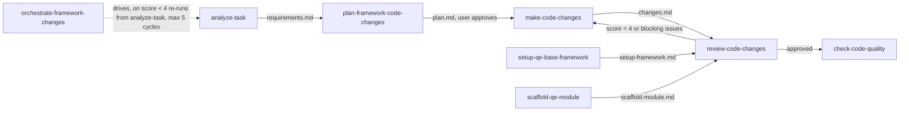

# Framework Design Principles (a–j)

The full, authoritative text — the 10 design principles made concrete for this repo, the
workspace-level and module-level layering rules, module-pairing conventions, the BOM
dependency-enforcement/override mechanism, and verification commands — lives in
[`.ai/skills/_shared/framework-guidelines.md`](../skills/_shared/framework-guidelines.md).
Every skill and agent plans, implements and reviews against that file. Point there instead of
re-deriving any of it; this file is intentionally a pointer, not a copy, so there is exactly one
place to update when the architecture changes.

## Non-negotiable repo rules (summary)

The authoritative text lives in `framework-guidelines.md` (above), `test-tagging.md` and
`self-test-verification-workflow.md` in this folder — always re-read those before acting, as they
may have grown since this summary was written. In short:

1. **BOM is the single source of truth for a managed dependency's version.** A base package's
   `package.json` never hardcodes a version its paired BOM package's `qe.bom.json` already
   manages (`framework-guidelines.md` §2.1, §5).
2. **Dependency direction is one-way.** `@qe/base-js` has no dependency on any other base
   package; `@qe/base-api-js`/`@qe/base-web-js`/`@qe/base-web-cucumber-js` depend only on
   `@qe/base-js` (§2.1 rule 3).
3. **No shared mutable state in `src/`.** Playwright Test runs fully parallel; per-test state
   goes through a `test.extend` fixture (§2.2 rule 3).
4. **Tagging.** Every self-test uses Playwright Test's `tag` option
   (`test('title', { tag: ['@unit', '@unique-scenario'] }, ...)`), never inline `@tag` text in
   the title. Each test has one unique kebab-case scenario tag that is not reused anywhere else.
5. **Explore/verify against local stubs before writing framework code that touches a
   browser/HTTP boundary.** See `self-test-verification-workflow.md`. There is no live external
   target anywhere in this repo.
6. **Check installed tool versions** (root `package.json` / the lockfile, and the npm registry)
   before pinning any version in a `qe.bom.json` or CI file.
7. **ESLint is flat-config only** (`eslint.config.mjs`).
8. **Verification = `pnpm --filter <pkg> build` + `pnpm --filter <pkg> test` + `pnpm -r lint` +
   `node .ci/enforce-bom-rules.mjs`.**
9. **A new managed dependency, or a new override allowance, is a deliberate BOM edit** — see
   `framework-guidelines.md` §5.1 — never an incidental side effect of adding a feature.
10. **Known environment gaps are not code defects** (e.g. no browser available in a sandboxed
    shell; no registry token configured yet for a live publish dry-run).

## Standard artifact locations

See `framework-guidelines.md` §7 for the full table (requirements, plans, change manifests,
reviews, quality reports, mutation reports, orchestration artifacts, scaffold-module artifacts,
framework-setup artifacts).

## Pipeline

