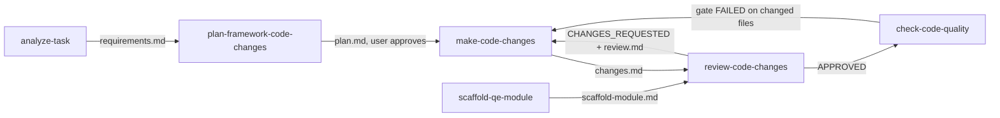

# AI Skills: QE Base JS Framework

Model- and tool-agnostic skills for building and maintaining this repo's multi-package BOM/base
framework library (TypeScript 5.x · pnpm workspaces · Playwright Test · Cucumber/playwright-bdd ·
Zod). Each skill is a plain-markdown `SKILL.md` with YAML front matter (`name`, `description`).
It works with any coding agent that can read files, run shell commands, and ask the user
questions.

## Pipeline skills

| Skill                                                                 | Input                                                             | Output                                                          |
| --------------------------------------------------------------------- | ----------------------------------------------------------------- | --------------------------------------------------------------- |
| [`analyze-task`](analyze-task/SKILL.md)                               | task text / ticket / file                                         | `docs/requirements/<slug>-requirements.md`                      |
| [`plan-framework-code-changes`](plan-framework-code-changes/SKILL.md) | requirements path, affected package(s), compatibility constraints | `docs/plans/<slug>-plan.md`                                     |
| [`make-code-changes`](make-code-changes/SKILL.md)                     | plan path (+ review/quality report for rework)                    | code + `docs/changes/<slug>-changes.md`                         |
| [`review-code-changes`](review-code-changes/SKILL.md)                 | change-manifest path                                              | `docs/reviews/<slug>-review-cycle-<n>.md` (1–5 scores, verdict) |
| [`check-code-quality`](check-code-quality/SKILL.md)                   | optional change-manifest path; `SONAR_TOKEN` env var              | `docs/quality/<slug>-quality.md`                                |

## Framework-specific skills (not part of the orchestrated loop)

| Skill                                                             | Input                                                                  | Output                                                                                                         |
| ----------------------------------------------------------------- | ---------------------------------------------------------------------- | -------------------------------------------------------------------------------------------------------------- |
| [`scaffold-qe-module`](scaffold-qe-module/SKILL.md)               | technology name + its package dependencies/libraries                   | `docs/framework/scaffold-module-plan.md` → code → `docs/framework/scaffold-module.md`                          |
| [`mutation-testing`](mutation-testing/SKILL.md)                   | this framework's own base-class/utility logic + its package self-tests | mutations injected into existing tests (gated by `MUTATION_ENABLED`), execution, and an evidence-backed report |
| [`setup-qe-base-framework`](setup-qe-base-framework/SKILL.md)     | scoping answers (packages to cover, registry, CI platform)             | `docs/plans/framework-setup-plan.md` (approval) → the scaffolded monorepo → `docs/setup-framework.md`          |
| [`learn-and-build-framework`](learn-and-build-framework/SKILL.md) | mode (LEARN / BUILD / INTERVIEW_PREP / ALL)                            | architecture walkthrough / step-by-step package construction / `docs/interview/framework-interview-guide.md`   |

## Standalone skills

| Skill                                                           | Input                                                                   | Output                                                                                              |
| --------------------------------------------------------------- | ----------------------------------------------------------------------- | --------------------------------------------------------------------------------------------------- |
| [`write-repo-learning-post`](write-repo-learning-post/SKILL.md) | repo (+ optional focus, audience, role, series history, existing draft) | `docs/linkedin-posts/<date>-<slug>.txt` (plain-text post; evidence and open questions in the reply) |

## Vendored (official Playwright skills, no pipeline agent)

| Skill                                                                   | Use when                                                                                                                                                                                                 |
| ----------------------------------------------------------------------- | -------------------------------------------------------------------------------------------------------------------------------------------------------------------------------------------------------- |
| [`playwright-cli`](playwright-cli/SKILL.md)                             | The mandated exploration tool in `.ai/context/self-test-verification-workflow.md` for any self-test against a local fixture/mock, and for ad hoc live-browser driving or inspecting/debugging a test run |
| [`playwright-component-testing`](playwright-component-testing/SKILL.md) | Setting up component tests for a UI-bearing package onto Playwright's story-gallery pattern                                                                                                              |
| [`playwright-trace`](playwright-trace/SKILL.md)                         | Inspecting a `.zip` trace file from the command line without opening the Trace Viewer UI                                                                                                                 |

## Shared references (loaded by the skills, not run on their own)

- [`_shared/framework-guidelines.md`](_shared/framework-guidelines.md): workspace + module
  layering, the 10 design principles, module-pairing conventions, **the BOM dependency
  enforcement/override mechanism**, verification commands, doc paths, result block
- [`_shared/change-manifest-template.md`](_shared/change-manifest-template.md): the "list of
  code changes" format that review and quality consume

## Typical flows

- **New framework capability:** `analyze-task` → `plan-framework-code-changes` →
  `make-code-changes` → `review-code-changes` (loop until `APPROVED`) → `check-code-quality`.
  Automated end to end by the [`framework-orchestrator-agent`](../agents/framework-orchestrator-agent.md).
- **New technology module pair:** `scaffold-qe-module` → `review-code-changes` → `check-code-quality`.
- **Greenfield / extending the monorepo itself:** `setup-qe-base-framework`.

## Conventions

- **Repo context** (entry point, tagging, self-test workflow, learnings) lives in
  [`.ai/context/`](../context/ai-assistant-instructions.md). The architecture itself lives in
  `_shared/framework-guidelines.md` (above), not in `context/`.
- **Hand off paths, not content.** Each skill reads its input documents from disk and ends with a
  `STATUS / OUTPUT / SUMMARY / NEXT` block, which is all the next step needs.
- **Human gates:** plans (both kinds) need explicit user approval before any code changes.
- **Strict evidence:** no invented dependency/library behaviour in plans, and no speculative test
  cases in reviews. Unknowns become open questions.
- **Secrets:** never in files, chat, or command lines. Registry/publish tokens come from the CI
  secret store / environment only.
- **Self-test execution** that launches a real browser or binds a local mock-server port runs
  outside any command sandbox your agent uses.
- Generated `docs/` artifacts are gitignored in this repo (local working documents). Durable
  lessons go to `.ai/context/framework-learnings.md`.

## Using with a specific agent

- **Any agent:** "Follow `.ai/skills/<skill>/SKILL.md` with input `<path or answers>`."
- **Tools with native skill discovery** (e.g. ones that read `.<tool>/skills/`): symlink or copy
  the skill folders there. Keep `.ai/skills` as the source of truth.
