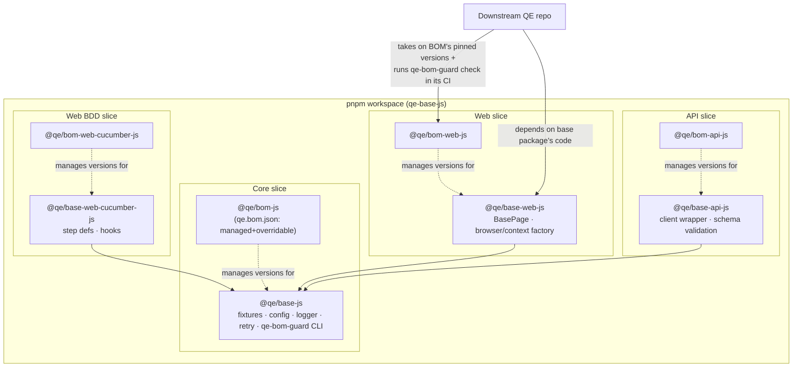

# Framework Architecture Reference

Full architectural mapping for `learn-and-build-framework`'s LEARN mode. Cross-reference against
`.ai/skills/_shared/framework-guidelines.md`, the single source of truth — this file explains the
_why_, that file states the _rule_.

## Layer map

## Why a BOM package per technology slice, not one flat manifest

A single root `package.json` with `overrides` would make every consumer either accept the whole
framework's dependency set unmodified or override anything with no guardrail. Splitting by
technology slice (core/api/web/web-cucumber) lets a consumer that only needs API testing take on
only `@qe/bom-api-js`'s managed set, and the `managed`/`overridable` split inside each BOM lets
the framework's maintainers say, precisely, which names are safe to override and which aren't —
the exact problem a flat `overrides` block can't express. See `framework-guidelines.md` §5.

## Why `test.extend` fixtures, not a `BaseTest`-style class hierarchy

The sibling Java framework uses class inheritance (`BaseTest` → `BaseApiTest`/`BaseWebTest`) with
`ThreadLocal` for per-thread isolation, because TestNG's execution model is thread-based.
Playwright Test's execution model is worker-process-based with its own fixture dependency
injection (`test.extend`), so the direct analogue of "per-thread isolated state" is "fixture
scope" — a worker-scoped fixture for anything expensive to set up once per worker (a shared
browser), a test-scoped fixture for anything that must be fresh per test (a page/context). There
is no class hierarchy to climb; composition replaces inheritance.

## Why Zod-validated config, not raw `process.env`

Every package's config module parses `process.env` once, at module load, through a Zod schema
with explicit defaults — so a missing or malformed env var fails fast and loud at startup rather
than producing a confusing runtime error deep in a self-test. This mirrors the sibling Java
framework's typed `*Config` classes, just validated declaratively instead of via hand-written
getters.

## Why mutation testing is hand-wired, not an automatic mutant-generation tool

An automatic engine (StrykerJS included) generates many mutants per run and expects you to triage
survivors after the fact — useful for a product codebase with a big test suite, but noisy for a
framework repo whose self-tests exist specifically to prove the framework's own contracts. The
hand-wired approach (one `mutation-test-map.csv` row per mutation, bound to one specific existing
test) makes the question "does our strongest test for X actually catch defect Y" decidable and
reviewable, matching the sibling Java repo's own custom approach rather than PIT's/Stryker's
automatic mode.

## Parallel-safety, end to end

- Playwright Test runs test files across worker processes, and tests within a file can run in
  parallel too (depending on config) — so "no shared mutable module-level state" isn't a style
  preference, it's required correctness.
- A fixture (`test.extend`) is the only place state should live: worker-scoped fixtures persist
  across tests in the same worker (e.g. a shared browser instance); test-scoped fixtures are
  fresh per test (e.g. a new browser context/page).
- The BOM enforcement CLI (`qe-bom-guard`) itself must be safe to run concurrently across CI
  shards — it only reads lockfiles/manifests and exits with a status code; it never mutates
  shared state.
