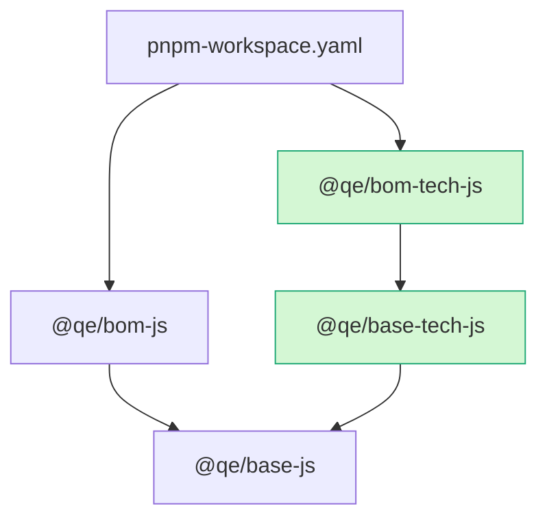
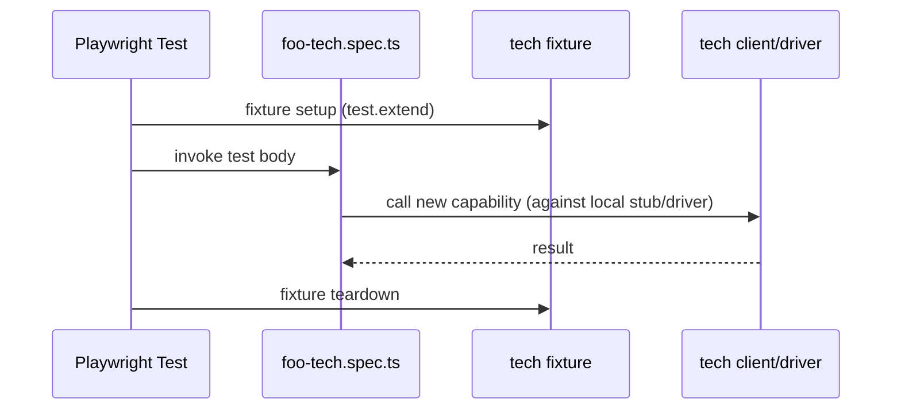

# scaffold-qe-module

## Purpose

Add a new `@qe/base-<tech>-js` (real source, directory `packages/base-<tech>-js`) +
`@qe/bom-<tech>-js` (no `src/`, directory `packages/bom-<tech>-js`) pair to the workspace,
following the design principles in `.ai/skills/_shared/framework-guidelines.md`, without
regressing any existing package.

Phases (never skip or reorder):
**1 collect inputs → 2 detect current state → 3 baseline → 4 plan →
5 approval gate → 6 implement → 7 verify no regression → 8 change manifest.**

## Phase 1: Collect inputs (one question per message)

Skip a question if the user already answered it. Echo back what you have.

**Q1. What technology/protocol is this package pair for?**
(e.g. mobile/Appium, GraphQL, gRPC, WebSocket, a new BDD runner). Derive the package names from
it: `@qe/base-<tech>-js`, `@qe/bom-<tech>-js` (kebab-case, matching the existing
`@qe/base-web-js`/`@qe/bom-web-js` naming), directories `packages/base-<tech>-js`,
`packages/bom-<tech>-js`.

**Q2. Which existing base package(s), if any, should the new one depend on?**

- `@qe/base-js` only (the common baseline every existing base package depends on), or
- also `@qe/base-api-js` / `@qe/base-web-js` / `@qe/base-web-cucumber-js`, if the new technology
  genuinely builds on one of them (e.g. a mobile package reusing the web package's context/page
  shape). Default: `@qe/base-js` only, mirroring how `@qe/base-web-cucumber-js` stayed
  independent of `@qe/base-web-js` rather than depending on it.

**Q3. Which third-party libraries will the new package need, and at what versions?** Don't
accept a version from memory — verify it resolves (the npm registry, or a trial
`pnpm add <pkg>@<version>` you then revert) before it goes in the plan.

## Phase 2: Detect the current state

Read the code, not only the README, and record the findings in the plan's "Current state"
section:

- Root `pnpm-workspace.yaml`: `packages:` glob/order, root `package.json` (shared devDependencies,
  scripts), root `tsconfig.base.json`, shared `eslint.config.mjs`/`.prettierrc`
- Each existing `@qe/bom-*-js` package's `package.json` + `qe.bom.json`: how it imports
  `@qe/bom-js`'s `managed` set and adds its own technology's versions
- Each existing `@qe/base-*-js` package's `package.json`, `src/index.ts` public surface, and
  `src/`/self-test tree: fixture shape, config module shape, client/browser-factory shape,
  `playwright.config.ts`
- Project memory/guideline files (`framework-guidelines.md` §8)

If the requested technology is close enough to an existing package that a new pair isn't
actually warranted (e.g. "add a GraphQL helper" might fit inside `@qe/base-api-js` instead of a
whole new pair), say so and ask the user to confirm before scaffolding a new pair. Don't scaffold
a redundant package.

## Phase 3: Baseline (the no-regression reference)

Run these outside any command sandbox that blocks browser process spawn or local socket binding
(`framework-guidelines.md` §6):

```bash
git rev-parse HEAD
git status --porcelain
pnpm -r exec tsc --noEmit
pnpm -r test          # whole workspace
```

Failures that exist before any change are **pre-existing**. They must not be counted against the
change, and must not be hidden either.

## Phase 4: Plan → `docs/framework/scaffold-module-plan.md`

Plan against the blueprint below. Every new dependency version must be one that actually
resolves and is compatible with the Node/TypeScript versions already in use. Check it (don't
copy a version from memory or from another repo).

### Blueprint: common to every new package pair

| Layer                                     | Artifact                                                                                                                                                                                                                                       |
| ----------------------------------------- | ---------------------------------------------------------------------------------------------------------------------------------------------------------------------------------------------------------------------------------------------- |
| root `pnpm-workspace.yaml`                | `packages/bom-<tech>-js` then `packages/base-<tech>-js` appended (BOM before base, matching the existing 8)                                                                                                                                    |
| BOM package (`packages/bom-<tech>-js/`)   | `package.json` (`private: true` or publishable, no `main`/`src`); `qe.bom.json` with `managed` entries importing/re-declaring `@qe/bom-js`'s set plus the new technology's own versions, and an empty or minimal `overridable` list. No `src/` |
| base package (`packages/base-<tech>-js/`) | `package.json` depending on `@qe/base-js` (and any other base package chosen in Q2) plus the new technology's libraries, every version matching `packages/bom-<tech>-js/qe.bom.json`'s `managed` map exactly                                   |
| public surface                            | `src/index.ts` exporting the new package's fixtures/classes, mirroring the nearest existing package's export shape                                                                                                                             |
| fixture/base                              | `src/fixtures.ts` (or the nearest existing package's naming), mirroring how `@qe/base-api-js`/`@qe/base-web-js` extend Playwright Test's `test` via `test.extend`                                                                              |
| config                                    | `src/config/<Tech>Config.ts`, mirroring `ApiConfig`/`WebConfig`-equivalent's typed-accessor style with sane defaults (Zod-validated)                                                                                                           |
| supporting modules                        | whatever the technology needs in its own sub-modules (`driver/`, `client/`, `util/`), mirroring the nearest existing package's module shape                                                                                                    |
| self-tests                                | `src/__tests__/<area>.spec.ts`, run against a **local** stub/emulator/mock — this repo has no live external target for any package, and the new one shouldn't be the first to need one                                                         |
| config                                    | `playwright.config.ts`, matching the other base packages' `fullyParallel`/`workers`/`retries` settings exactly unless the plan gives a reason to diverge                                                                                       |
| docs                                      | `README.md`: a new subtree under "Project Architecture", a new "Managed Dependencies" table for the new BOM, a new numbered "Pattern N" consumption section mirroring the existing patterns                                                    |

### Plan template

````markdown
# Scaffold Module Plan: @qe/base-<tech>-js / @qe/bom-<tech>-js

| Field                               | Value                           |
| ----------------------------------- | ------------------------------- |
| Status                              | Draft / Approved (YYYY-MM-DD)   |
| Technology                          | <mobile / GraphQL / gRPC / …>   |
| Depends on (existing base packages) | @qe/base-js [, @qe/base-api-js] |
| Base commit                         | `<sha>`                         |

## 1. Inputs

## 2. Current state (detected)

| Capability | Nearest existing analog | Evidence (path) |

## 3. Baseline test run

<command, per-package pass/fail counts, pre-existing failures by name>

## 4. Target architecture

### 4.1 Workspace structure: before → after



### 4.2 Package / folder tree (new package, new + modified entries marked)

### 4.3 Execution workflow (one representative test)



## 5. Dependencies & build changes

| Package | Version (verified how) | Managed in (qe.bom.json) | Why |

## 6. File-level change list (implementation order)

| # | Path | Change | Layer | Details |

## 7. Documentation changes

<README.md sections to add/update, matching the existing patterns' format>
````

## Phase 5: Approval gate

Stop. Present the plan path and a short summary. Make no code changes before explicit approval.

## Phase 6: Implement

Implement exactly the approved plan, in the order the file-level change list gives, matching
`.ai/skills/_shared/framework-guidelines.md` §2's hard layering rules throughout — most
importantly: the BOM package gets no real source, and every version the base package depends on
matches its BOM's `qe.bom.json` `managed` map exactly.

## Phase 7: Verify no regression

Re-run the Phase 3 baseline commands plus the new package's own build/test, and diff against the
baseline: no previously-passing package/test regresses, and `node .ci/enforce-bom-rules.mjs`
passes for the whole workspace including the new pair.

## Phase 8: Change manifest

Write `docs/framework/scaffold-module.md` using `.ai/skills/_shared/change-manifest-template.md`.
Next: `review-code-changes docs/framework/scaffold-module.md`.
